<div align="center">


# Nexora CRM

**A full-featured, bilingual (English / العربية) sales CRM** — leads, contacts, companies, a drag-and-drop pipeline, activities, reports, role-based access and an audit trail, built with Next.js, TypeScript and PostgreSQL.

[](https://github.com/Mohamed-Mohsen2003/Mohamedcrm/actions/workflows/ci.yml)


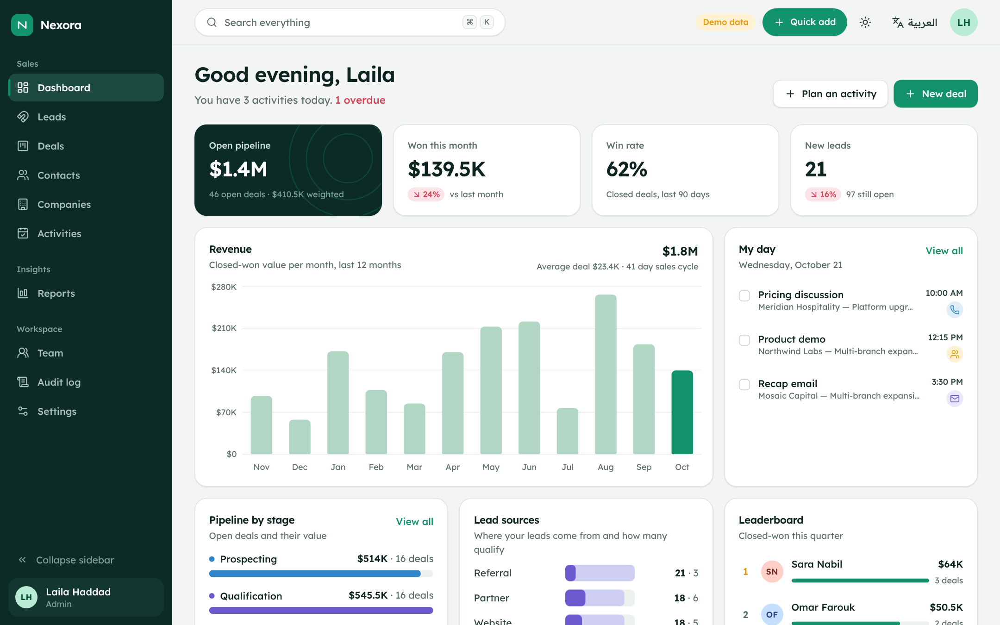

</div>

> All companies, people and numbers in this project are fictional demo data generated by the seed script.

## Try it in 30 seconds

```bash
git clone https://github.com/Mohamed-Mohsen2003/Mohamedcrm.git
cd Mohamedcrm
npm install
npm run dev
```

Open http://localhost:3000 and click **Open the live demo**. No database setup is needed: without a `DATABASE_URL` the app runs on an embedded PostgreSQL (PGlite), migrates itself and seeds a realistic workspace on first boot.

| Role | Email | Password | What they can do |
| --- | --- | --- | --- |
| Admin | `admin@nexora.demo` | `demo1234` | Everything, including team, pipeline stages and workspace reset |
| Manager | `manager@nexora.demo` | `demo1234` | Edit every record, export, reports and audit log |
| Sales rep | `rep@nexora.demo` | `demo1234` | Work and edit their own records |

## Features

**Sales workspace**
- **Dashboard** — open pipeline and weighted forecast, won this month vs last, win rate, 12-month revenue, pipeline by stage, lead sources, team leaderboard, today's agenda and a live activity feed.
- **Leads** — searchable, sortable, paginated table with filters, bulk assign / status / delete, lead scoring, CSV export and a **convert lead** flow that creates the contact, company and deal in one transaction.
- **Deals** — Kanban pipeline with drag and drop (mouse, touch and keyboard), per-stage totals and weighted value, lost-reason capture, overdue close dates, plus a list view.
- **Contacts & companies** — profiles with related deals, activity timeline and notes.
- **Activities** — calls, meetings, emails and tasks with due dates, overdue tracking and one-click completion.
- **Reports** — revenue trend, win/loss and lost reasons, source conversion, rep performance and forecast.
- **Command palette** — `Ctrl/⌘ + K` to search every record and jump anywhere.

**Platform**
- **Role-based access control** (admin, manager, rep) enforced on the server in every action, query and API route — not just hidden in the UI.
- **Audit log** of every create, update, move and delete, with actor and timestamp.
- **Bilingual with full RTL** — English and Arabic, localized dates, numbers and currency, mirrored layouts.
- **Light and dark themes**, respecting the system preference.
- **Accessible** — keyboard navigation, focus rings, skip link, ARIA labels, `prefers-reduced-motion` respected.
- **Validation** with Zod on the server, with field-level errors surfaced in forms.
- **SEO** — localized metadata, canonical and `hreflang` links, dynamic Open Graph image, sitemap, robots, web manifest and JSON-LD structured data. The app area is `noindex`.
- **Security headers** (HSTS, frame denial, nosniff, referrer and permissions policies), signed HTTP-only session cookies, bcrypt passwords and safe redirects.

## Screenshots

| | |
| --- | --- |
| 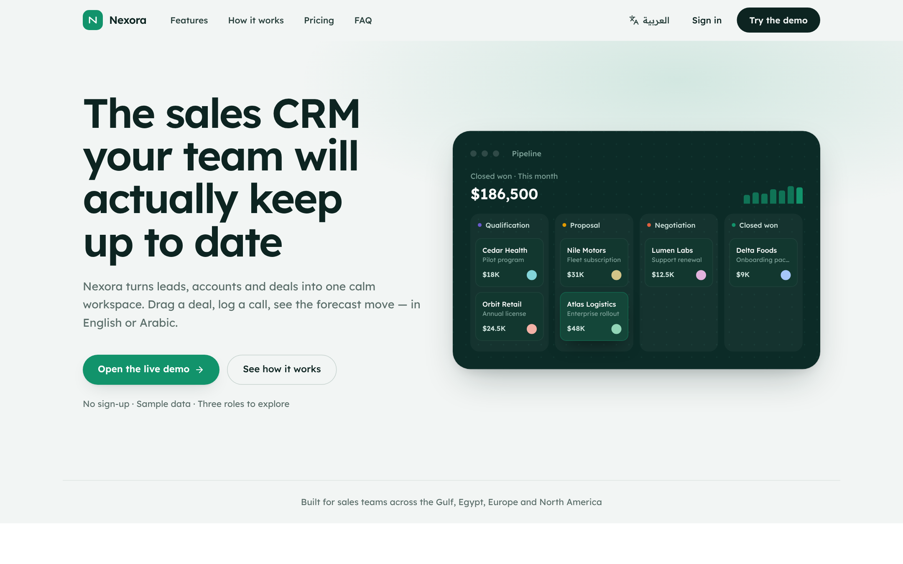 | 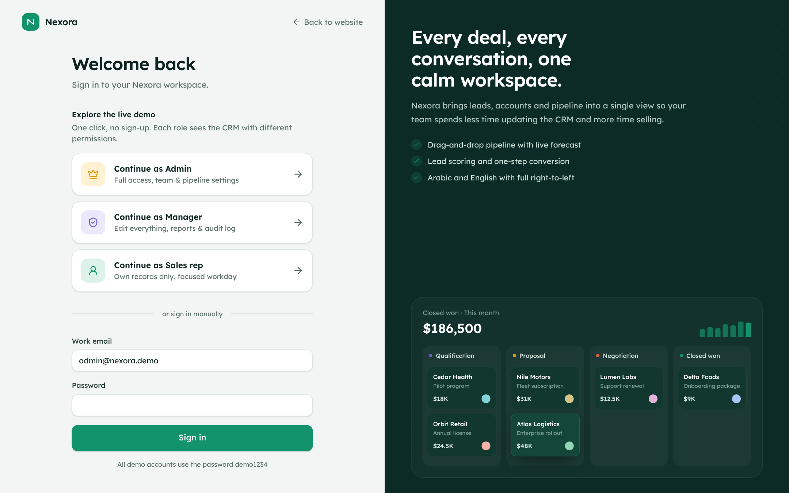 |
| 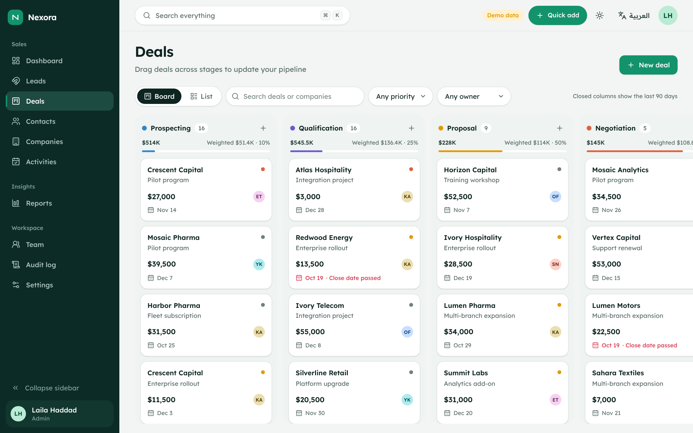 | 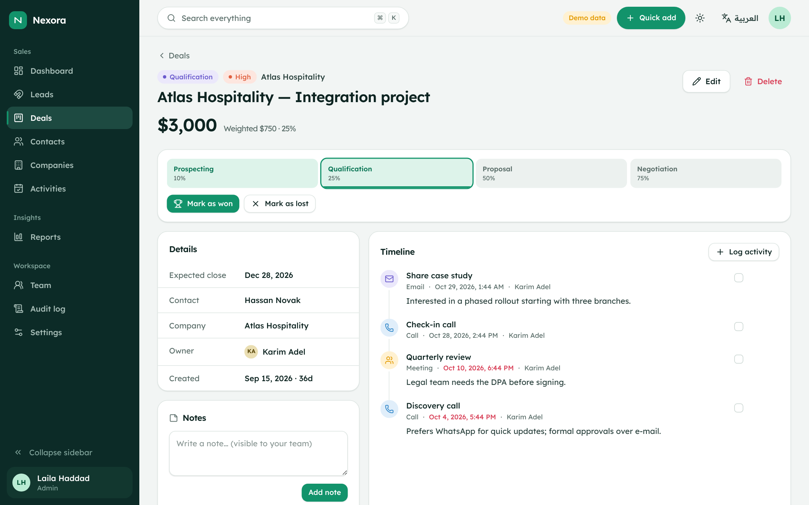 |
| 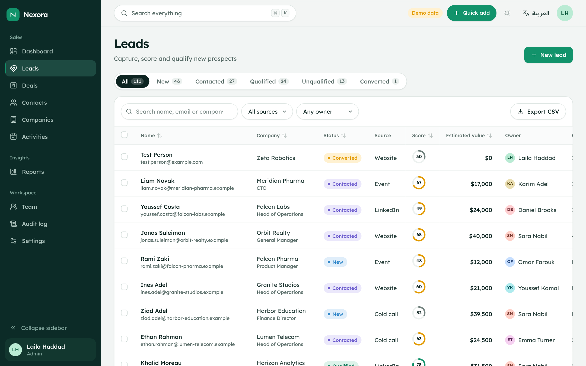 | 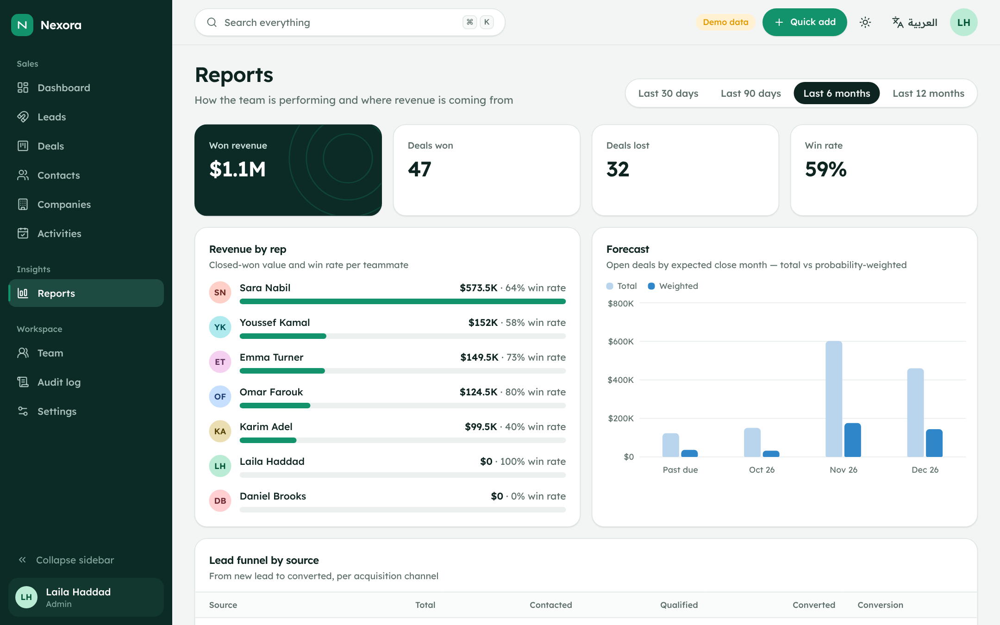 |
| 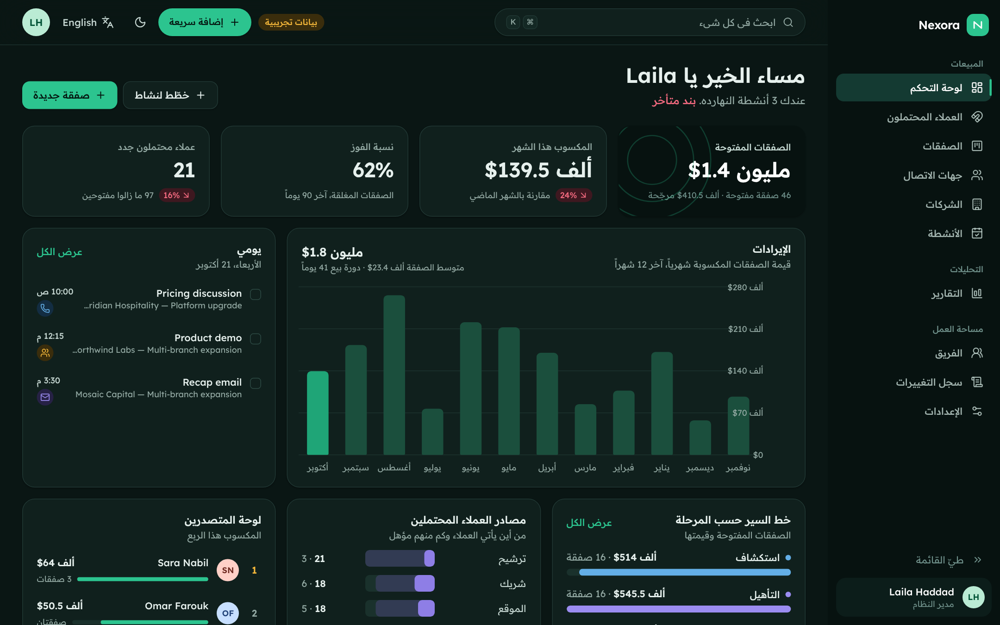 | 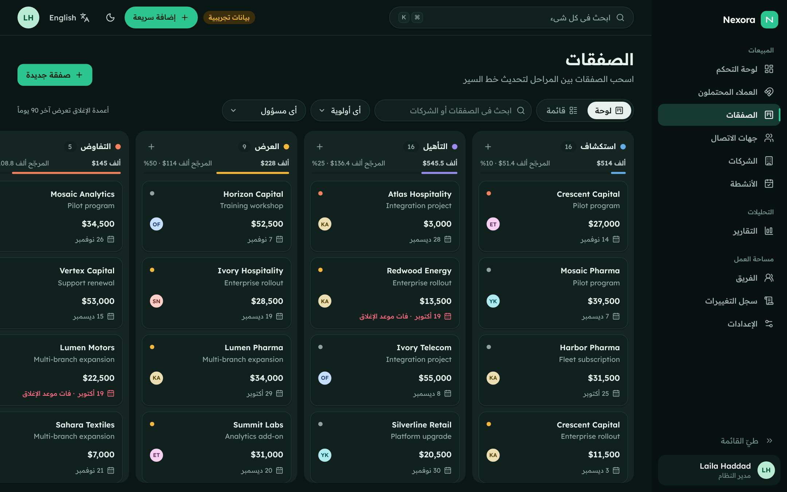 |
| 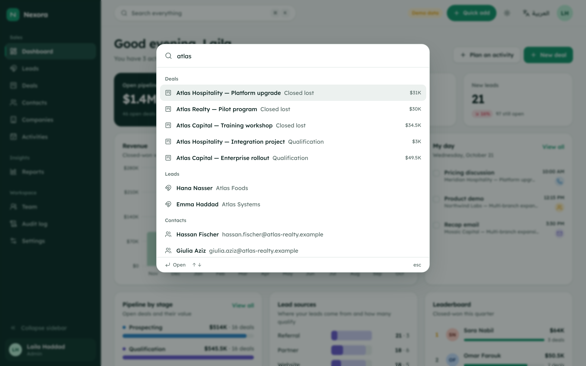 | 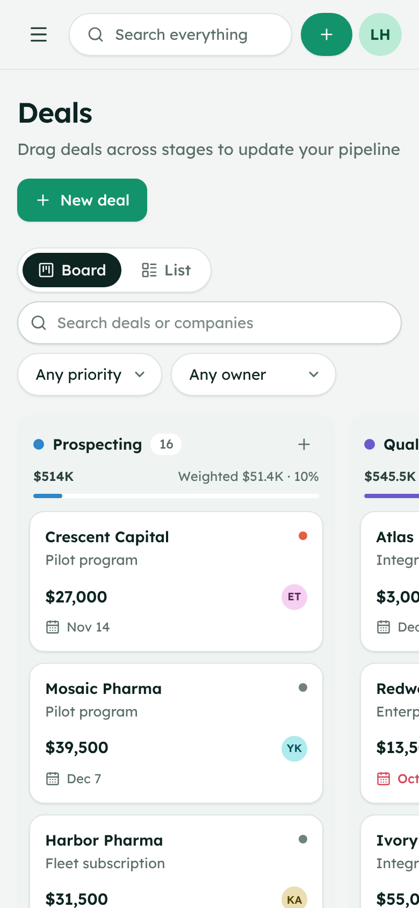 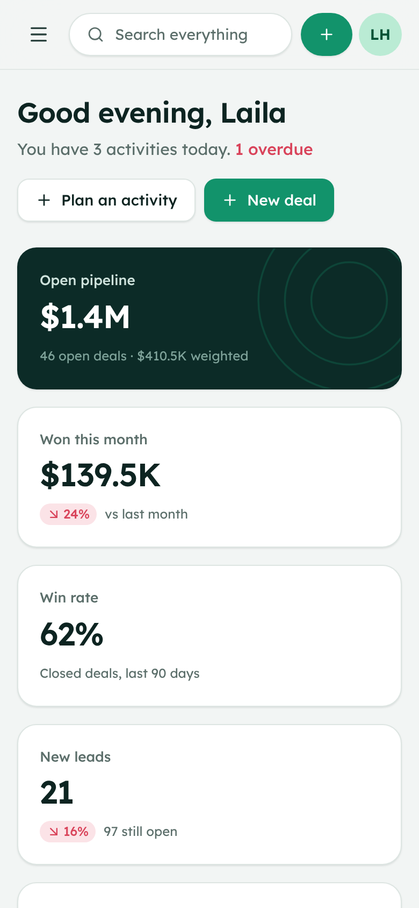 |

## Tech stack

| Layer | Choice |
| --- | --- |
| Framework | Next.js 16 (App Router, Server Components, Server Actions), React 19 |
| Language | TypeScript (strict) |
| Database | PostgreSQL via Drizzle ORM; embedded PGlite fallback for zero-setup demos |
| Auth | JWT sessions (jose) in HTTP-only cookies, bcrypt password hashing |
| Styling | Tailwind CSS v4 with design tokens, Radix UI primitives |
| Motion | Motion (Framer Motion), dnd-kit for drag and drop |
| Charts | Recharts |
| i18n | next-intl (English, Arabic, RTL) |
| Testing | Vitest (unit), Playwright (end-to-end, desktop + mobile) |
| Delivery | GitHub Actions CI, Docker multi-stage image, Docker Compose with PostgreSQL |

## Architecture

```
src/
├── app/[locale]/
│   ├── (marketing)/      Landing page (static, SEO)
│   ├── (auth)/login/     Sign-in and one-click demo roles
│   └── app/              The CRM — dashboard, leads, deals, contacts, companies,
│                         activities, reports, team, audit log, settings
├── app/api/              Search, CSV export, health check
├── components/           UI primitives and feature components
├── lib/
│   ├── auth/             Sessions, tokens, RBAC permission matrix
│   ├── db/               Drizzle schema, connection, demo seed
│   ├── i18n/             Routing and message loading
│   └── validation/       Zod schemas shared by forms and actions
├── server/
│   ├── actions/          Mutations — every one checks permissions and writes the audit log
│   └── queries/          Read models for pages and dashboards
└── messages/             en.json, ar.json
```

Every mutation follows the same path: **authenticate → authorize (RBAC + record ownership) → validate (Zod) → write in a transaction → audit → revalidate**. Records are scoped to an organization, so the schema is ready for multi-tenant use.

## Running with PostgreSQL

```bash
cp .env.example .env          # set DATABASE_URL and AUTH_SECRET
npm run db:migrate
npm run db:seed               # or: npm run db:reset to start over
npm run dev
```

Or run everything in containers:

```bash
docker compose up --build     # app on http://localhost:3000 + PostgreSQL 17
```

| Variable | Purpose |
| --- | --- |
| `DATABASE_URL` | PostgreSQL connection string. Leave empty to use embedded PGlite. |
| `AUTH_SECRET` | Secret for signing sessions, at least 32 characters (`openssl rand -base64 32`). |
| `NEXT_PUBLIC_SITE_URL` | Public URL, used for canonical links, sitemap and Open Graph. |
| `DEMO_MODE` | `true` seeds demo data on first boot when the database is empty. |

## Quality

```bash
npm run check        # typecheck + lint + unit tests
npm run build
npm run test:e2e     # Playwright: auth, every module, CRUD, validation, RBAC, Arabic RTL, mobile overflow
```

CI runs the full suite on every push, with the end-to-end tests against a real PostgreSQL service.

## Deploying

The app deploys to Vercel as is. Add a managed PostgreSQL (Neon, Supabase, Vercel Postgres) as `DATABASE_URL` and set `AUTH_SECRET`. Without `DATABASE_URL` it still runs on in-memory PGlite, which is handy for previews but resets when the server restarts.

## Author

Built by **[Mohamed Mohsen](https://github.com/Mohamed-Mohsen2003)** — full-stack developer and UI/UX designer.

Licensed under the [MIT License](LICENSE). Fonts: Readex Pro (SIL Open Font License).
